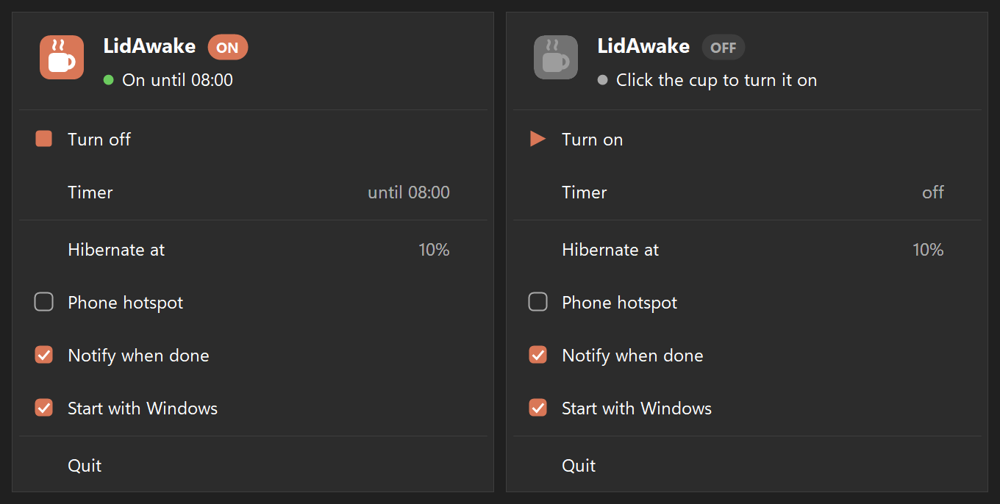

# LidAwake

Keep a Windows laptop working with the lid closed while a job runs, like a MacBook does. When the job
finishes, every power setting goes back to how it was. If the lid is still closed then, the laptop hibernates:
it powers off with everything saved, and opening it resumes exactly where it was.



Built for long [Claude Code](https://claude.com/claude-code) runs. On Windows, closing the lid puts the laptop to
sleep even when an app asks it to stay awake. That includes the Claude desktop app's *Keep computer awake* toggle,
because Windows keep-awake requests only block *idle* sleep, not the lid. LidAwake changes the lid action itself
for as long as the job runs.

- **Lives in the tray.** Click the coffee cup to turn it on (coral) or off (grey). While off it changes nothing
  and uses no CPU. Right-click for the menu: *Timer* (1 h, 2 h or until 8:00), *Hibernate at* (battery level),
  *Phone hotspot*, *Notify when done* and *Start with Windows* (on by default).
- **No admin and no network.** One small exe (about 150 KB) that uses the .NET Framework built into Windows.
  No service and no scheduled task.

## What it does while it is on

| | While on | After |
|---|---|---|
| Lid close action (plugged in and on battery) | *Do nothing*: the screen turns off and the PC keeps working | your setting again |
| *Put the computer to sleep after…* and the lock-screen sleep timeout | *Never* (on Modern Standby laptops a keep-awake request alone stops working ~5 min after this timer runs out) | your setting again |
| Screen | turns off as usual. On Modern Standby laptops a screen that turns off puts the whole laptop into standby and the job stops, so there it turns **black** at that moment instead (on OLED, black pixels are off, so nothing burns in). Any key or mouse move brings it back. If a video keeps the screen on, nothing changes | as before |
| Lid closed while on battery | power mode *Best power efficiency* (Settings → System → Power) | your mode again, the next time the laptop is on battery |
| Battery drops to your threshold (10% by default) with the lid closed | hibernates so nothing is lost; the job carries on when you open it | |
| Job ends while the lid is closed | | hibernates (everything saved, laptop off) |

Your original values are saved to `%LOCALAPPDATA%\LidAwake\restore.txt` **before** anything changes. If
LidAwake is ever killed, the next start puts them back first. You can also run `LidAwake restore` at any time.

## Install

Download `LidAwake.exe` from [Releases](https://github.com/Mqr1oo/LidAwake/releases/latest) and **double-click
it**. That's all:

- it installs itself to `%LOCALAPPDATA%\Programs\LidAwake\`, adds **LidAwake** to the Start menu, sits in the
  tray and starts with Windows;
- if Claude Code is installed, it asks once: *Connect LidAwake to Claude Code?* Click **Yes** and it adds the
  hooks below to `%USERPROFILE%\.claude\settings.json`, keeping everything else and saving a backup first. It
  also adds a note to `%USERPROFILE%\.claude\CLAUDE.md` that tells Claude what LidAwake does and which commands
  control it, so you can just ask Claude ("keep the laptop awake until 8", "hibernate at 20%").

Downloading a newer version and double-clicking it updates in place. `LidAwake connect` / `LidAwake disconnect`
add or remove the Claude Code part later.

## Timer and notifications

- **Timer.** In the menu, *Timer* changes on each click: 1 hour, 2 hours, until 8:00, off.
  It turns LidAwake on, and when the time is up LidAwake turns off (and hibernates if the lid is closed), unless
  Claude is still working. From a terminal: `LidAwake for 2h`, `LidAwake until 8:00`.
- **Hibernate threshold.** *Hibernate at* changes on each click (5 to 30%), or `LidAwake battery 15`.
- **Notify when done** (on by default): a notification when Claude finishes a job that took longer than
  2 minutes, and when a timer ends. `LidAwake notify off` turns it off.

## Phone hotspot (optional)

Tick **Phone hotspot** in the tray menu. Now, as soon as you close the lid while LidAwake is on, it turns on your
phone's hotspot and connects the laptop to it, even if it was on Wi-Fi. So when you leave with the laptop in a
bag, the work stays online without a gap. It opens the Wi-Fi list for a moment, presses **Connect** on your
phone, then checks that the laptop is really online. If that fails it tries again every minute; once connected,
it only tries again if the internet drops. It uses your mobile data while the lid is closed.

**One-time setup first.** Without it the option can't work:

1. Link your Android phone with **Phone Link** (on the phone: **Link to Windows**). The phone then shows up in
   **Settings → Bluetooth & devices → Mobile devices**.
2. In **Phone Link → Settings → Features → Instant hotspot**, click **Set up** and approve it on the phone.
3. Check it: open the Wi-Fi list on the laptop. Your phone should be listed as *"Mobile hotspot, off"* even
   while its hotspot is off. Clicking it should start the hotspot. If that works, LidAwake can do it.

Keep Bluetooth on, on both the laptop and the phone. Instant hotspot works only with phones that support it
(many Android phones; not iPhone), and it uses your mobile data.

## Uninstall

**Settings → Apps → Installed apps → LidAwake → Uninstall**, like any other app (or run `LidAwake uninstall`).
This puts your power settings back and removes the hooks and the note from Claude Code (the rest of
those files is kept). It also deletes the program and its log, the Start menu entry and the
start-with-Windows entry.

## Use it by hand

Click the coffee cup in the tray, or open **LidAwake** from the Start menu. The cup turns coral. Close the lid
and the work keeps going. Click the cup again when you are done.

## Let Claude Code turn it on and off

The installer adds these for you (see above). To add them by hand instead, merge this into
`%USERPROFILE%\.claude\settings.json`; `LidAwake hooks` prints it with your own path. Claude Code also reads
this file for sessions in the Claude desktop app's Code tab.

```json
{
  "hooks": {
    "UserPromptSubmit": [ { "hooks": [ { "type": "command", "command": "C:\\Users\\YOU\\AppData\\Local\\Programs\\LidAwake\\LidAwake.exe", "args": ["hook"], "timeout": 10 } ] } ],
    "Stop":             [ { "hooks": [ { "type": "command", "command": "C:\\Users\\YOU\\AppData\\Local\\Programs\\LidAwake\\LidAwake.exe", "args": ["hook"], "timeout": 10 } ] } ],
    "StopFailure":      [ { "hooks": [ { "type": "command", "command": "C:\\Users\\YOU\\AppData\\Local\\Programs\\LidAwake\\LidAwake.exe", "args": ["hook"], "timeout": 10 } ] } ],
    "SessionEnd":       [ { "hooks": [ { "type": "command", "command": "C:\\Users\\YOU\\AppData\\Local\\Programs\\LidAwake\\LidAwake.exe", "args": ["hook"], "timeout": 10 } ] } ]
  }
}
```

How it decides:

- **Sending a prompt** turns LidAwake on for that session.
- **Claude finishing its reply** turns it off for that session, unless background work (agents, workflows,
  background shells) is still running. In that case it stays on until that work finishes too.
- **Several sessions** can hold it at once. It stops 60 seconds after the last one lets go.
- **If Claude Code exits or crashes,** its hold is dropped. A hold that hears nothing for 4 hours is dropped too.
  This covers turns you interrupt with Esc, which send no Stop event.
- **The hook never blocks Claude:** it prints nothing and always exits 0.

## Command line

```
LidAwake              double-click: installs, or turns on once installed
LidAwake start [id]   keep awake for a job          LidAwake stop [id]   that job is done
LidAwake off          stop now                      LidAwake status      show state
LidAwake restore      put power settings back       LidAwake hook        used by the hooks above
LidAwake install      install (= double-click)      LidAwake uninstall
LidAwake connect      add the Claude Code hooks     LidAwake disconnect  remove them
LidAwake on           turn on                       LidAwake quit        leave the tray
LidAwake hooks        print the hooks JSON
LidAwake for 2h       on now, off after 2h (90m, 1.5h; "for off" clears it)
LidAwake until 8:00   on now, off at 8:00
LidAwake battery 15   hibernate at 15% with the lid closed (3-50)
LidAwake notify on|off    LidAwake hotspot on|off
```

The log is at `%LOCALAPPDATA%\LidAwake\lidawake.log`.

## Build

Windows 10 or 11 already has everything needed:

```
powershell -ExecutionPolicy Bypass -File build.ps1
```

This produces `bin\LidAwake.exe` using the in-box `csc.exe` (.NET Framework 4.x). Set `LIDAWAKE_DRYRUN=1` to
try it without writing any power setting.

## Limits

- Desktop PCs have no lid. On those it only blocks idle sleep.
- If you lock the PC (Win+L), Windows turns the screen off after its lock-screen timeout and a Modern Standby
  laptop pauses the job. Close the lid instead of locking.
- If your organisation locks power settings, LidAwake shows a warning in the tray menu.
- Some vendor tools (for example G-Helper on ASUS laptops) put the lid setting back when the lid opens. LidAwake
  notices within a second and sets it again while it is on.
- A laptop working with the lid shut in a bag gets warm. The efficient power mode helps, but don't seal it in a sleeve for hours.

---

### Pe scurt (română)

LidAwake ține laptopul pornit cu capacul închis cât timp lucrează Claude (sau cât îl pornești tu). Ecranul se
stinge (sau devine negru), iar pe baterie trece pe modul de putere cel mai economic. Când treaba e gata, inclusiv taskurile din fundal, pune setările
înapoi exact cum erau. Dacă capacul e încă închis, laptopul intră în hibernate: se oprește cu tot salvat. Tot
așa face dacă bateria ajunge la 10% cu capacul închis. Nu rulează în fundal, nu cere
admin și nu folosește internetul. Pornești din Start → **LidAwake** și oprești din iconița cu cana de cafea din tray.

MIT License.
